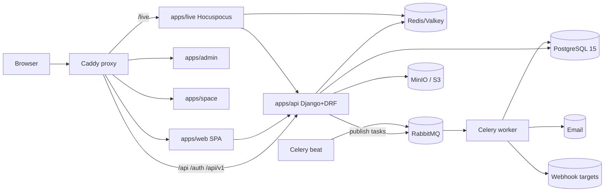
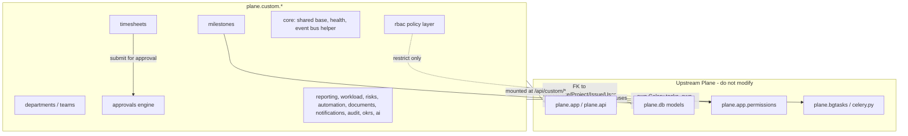
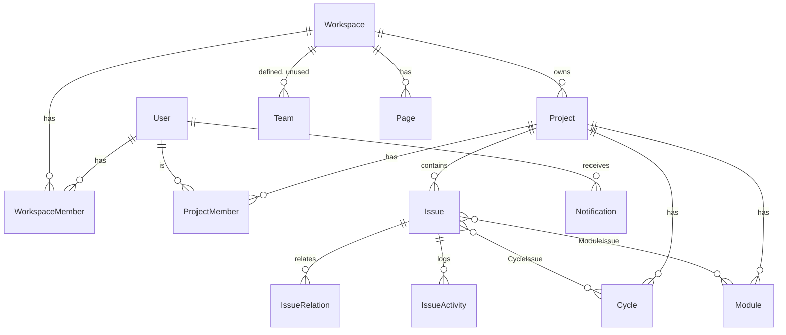
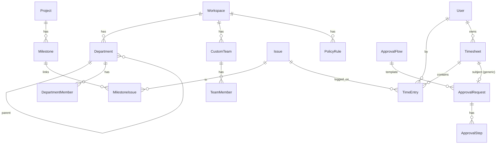

# 03 — System Architecture

Facts about the existing system are from `02-REPOSITORY-ANALYSIS.md`. Everything under "Proposed" is a **design proposal awaiting product-owner approval**.

## 1. Existing architecture



## 2. Proposed custom architecture (modular monolith)

Custom code lives **inside the same Django project** under `plane/custom/<module>/`, each module a Django app; nothing is a separate service.



**Module boundaries (rules)**

1. A custom module may import `plane.db.models` and `plane.app.permissions`; core code **never** imports custom code. (Only two core edits are permitted: `INSTALLED_APPS` and the `/api/custom/` include — already made.)
2. Custom modules may depend on each other only along the DAG in §8; no cycles.
3. Custom tables are separate (`custom_<module>_*` via explicit `db_table`), FK **to** core tables, never the reverse. No `ALTER` on core tables.
4. Cross-module calls go through a module's `services.py`, not its models/views.
5. Custom Celery tasks live in `plane/custom/<module>/tasks.py`; beat entries added through a custom settings hook (see §6), not by editing `celery.py`.

## 3. Database relationships

### 3.1 Existing (relevant subset)



### 3.2 Proposed custom (full detail in `04-DATABASE-DESIGN.md`)



## 4. Module catalog (Task 5)

"Seam" = existing frontend `*extended*` hook point. "Conflict risk" = chance of merge conflict on upstream sync (L/M/H).
PRs 1–6 modules are detailed in docs 04–10; the rest are summarized here and **deferred** (D5).

| #   | Module                       | Plane dependencies                                                                                       | New models                                                               | API (`/api/custom/…`)                              | Frontend integration                                                    | Authorization                           | Background                            | Tests                                | Conflict risk                                               |
| --- | ---------------------------- | -------------------------------------------------------------------------------------------------------- | ------------------------------------------------------------------------ | -------------------------------------------------- | ----------------------------------------------------------------------- | --------------------------------------- | ------------------------------------- | ------------------------------------ | ----------------------------------------------------------- |
| 1   | Departments                  | `Workspace`, `WorkspaceMember`, `User`                                                                   | `Department`, `DepartmentMember`                                         | `workspaces/<slug>/departments/`                   | New route via `routes/extended.ts`; sidebar via `extended-sidebar-item` | Workspace ADMIN to manage; MEMBER read  | none                                  | unit + contract                      | L                                                           |
| 2   | Teams & memberships          | dormant `Team` (see Open Q1), `WorkspaceMember`, `Project`                                               | `TeamMember` (+ optionally `CustomTeam`)                                 | `workspaces/<slug>/teams/`                         | route + sidebar seam                                                    | ADMIN manage, MEMBER view               | none                                  | unit + contract                      | L (L→M if existing `Team` table is reused)                  |
| 3   | Custom RBAC                  | `plane.app.permissions`, `ROLE`, `WorkspaceMember`, `ProjectMember`                                      | `PolicyRule`, `PolicyAssignment`                                         | `rbac/`                                            | settings page via route seam                                            | Workspace ADMIN only; **restrict-only** | cache invalidation task               | unit (policy eval matrix) + contract | M (decorator adoption touches views if applied inside core) |
| 4   | Milestones & timeline        | `Project`, `Issue`, `IssueRelation`, `Module`, `Cycle`, Gantt UI, `packages/types/.../gantt/extended.ts` | `Milestone`, `MilestoneIssue`, `MilestoneDependency`                     | `projects/<id>/milestones/`                        | Gantt `extended.ts` types + new route                                   | Project MEMBER create/edit, GUEST read  | derived-status refresh task           | unit + contract                      | L (backend) / M (Gantt UI)                                  |
| 5   | Timesheets & timer           | `Issue`, `Project.is_time_tracking_enabled`, `User`                                                      | `TimeEntry`, `Timesheet`, `ActiveTimer`                                  | `time/entries/`, `time/timesheets/`, `time/timer/` | issue-detail extension + new page                                       | Owner edit own; approvers via module 6  | stale-timer sweeper (beat)            | unit + contract                      | L                                                           |
| 6   | Approval engine              | `User`, `WorkspaceMember`, notifications                                                                 | `ApprovalFlow`, `ApprovalRequest`, `ApprovalStep`, `ApprovalAction`      | `approvals/`                                       | inbox page + notification entries                                       | Step approver or ADMIN                  | escalation/expiry beat task, notifier | unit (state machine) + contract      | L                                                           |
| 7   | Advanced reporting           | `plane.analytics`, `AnalyticView`, `TimeEntry`, `Milestone`                                              | `ReportDefinition`, `ReportSnapshot`                                     | `reporting/`                                       | route seam                                                              | RBAC-filtered queries                   | snapshot/export tasks                 | unit + query-count tests             | L                                                           |
| 8   | Resource & workload          | `Issue.assignees`, estimates, `Cycle`, `TimeEntry`, `Department`                                         | `Capacity`, `Allocation`                                                 | `workload/`                                        | route seam                                                              | Dept lead/ADMIN                         | none initially                        | unit                                 | L                                                           |
| 9   | Project risks                | `Project`, `Issue` (optional link), `User`                                                               | `Risk`, `RiskMitigation`                                                 | `projects/<id>/risks/`                             | route seam                                                              | Project MEMBER                          | review-due reminder                   | unit + contract                      | L                                                           |
| 10  | Recurring tasks & automation | `Issue`, `State`, `Project`, Celery beat                                                                 | `RecurrenceRule`, `AutomationRule`, `AutomationRun`                      | `automation/`                                      | route seam                                                              | Project ADMIN                           | beat scan + spawn tasks               | unit + time-freeze                   | L                                                           |
| 11  | Document management          | `Page`, `PageVersion`, `FileAsset`, live server                                                          | `DocumentFolder`, `DocumentMeta` (links to `Page`/`FileAsset`)           | `documents/`                                       | route seam                                                              | folder ACL via RBAC                     | none                                  | contract                             | L                                                           |
| 12  | Notification center          | `Notification`, `UserNotificationPreference`, `EmailNotificationLog`                                     | `NotificationChannel`, `NotificationRule`                                | `notifications/`                                   | extend existing notifications UI                                        | per-user                                | dispatch tasks                        | unit                                 | M (overlaps core notification code)                         |
| 13  | Audit logs                   | `IssueActivity` (issue-only), `APIActivityLog`                                                           | `AuditEvent`                                                             | `audit/`                                           | admin route seam                                                        | Workspace ADMIN read-only               | async writer                          | unit + immutability                  | L                                                           |
| 14  | Company OKRs                 | `Workspace`, `Department`, `Project`/`Issue` links                                                       | `Objective`, `KeyResult`, `KRLink`, `CheckIn`                            | `okrs/`                                            | route seam                                                              | by department                           | progress rollup                       | unit                                 | L                                                           |
| 15  | AI assistant                 | read-only through custom services honoring RBAC                                                          | `AIConversation`, `AIMessage` (provider config reused from core `LLM_*`) | `ai/`                                              | panel via seam                                                          | caller's own permissions only           | async inference                       | mocked-LLM tests                     | L                                                           |

## 5. API integration strategy

- All custom endpoints under `/api/custom/<module>/` (one include per module in `plane/custom/core/urls.py`) — the only core hook is the already-added `path("api/custom/", …)`.
- Reuse `BaseViewSet`/`BaseAPIView` from `plane.app.views.base` for timezone, read-replica and pagination behavior; session auth only for v1 (same as `/api/`). API-token access (`/api/v1/` style) is deferred.
- Workspace routing uses the same `<slug>` convention as core: `/api/custom/workspaces/<slug>/…`.
- Serializers in each module; no changes to core serializers. OpenAPI docs via the existing opt-in spectacular setting.

## 6. Background-processing strategy

Reuse the existing Celery app/broker. Verified in `plane/celery.py`: `app.autodiscover_tasks()` (so any custom app in `INSTALLED_APPS` with a `tasks.py` is picked up) and `beat_scheduler = django_celery_beat...DatabaseScheduler`. Custom beat entries can therefore be registered from a custom `AppConfig.ready()` (`app.conf.beat_schedule.update(...)`) or as `PeriodicTask` rows via a data migration — no `celery.py` edit needed. **To be proven in the first module that needs a schedule.**

**Correction to `DECISIONS.md` D1:** "one line in `INSTALLED_APPS`" is only enough for `plane.custom.core`. Every custom module that has models/tasks must itself be an installed app. Recommended: replace the single core line with `*CUSTOM_INSTALLED_APPS` imported from `plane/custom/apps_list.py` (one core-line edit, once), so adding modules never touches core again. Alternatively, `core.apps.ready()` cannot add apps. **Done in PR 2 (approved 2026-11-21):** `settings/common.py` now splats `CUSTOM_INSTALLED_APPS` from `plane/custom/apps_list.py`. Beat registration via `AppConfig.ready()` was verified (`app.conf.beat_schedule` contains the entry).

## 7. Permission architecture

See `06-RBAC-PERMISSION-DESIGN.md`. Core check first (`@allow_permission`), then custom `PolicyLayer` which can only **deny/narrow**. Resource ownership checks (own timesheet, own entry) are in module services.

## 8. Approval architecture

See `07-APPROVAL-WORKFLOW.md`. Generic `ApprovalRequest` (subject = `content_type` + `object_id`) with ordered steps and an explicit state machine; modules register a "subject adapter" (what to do on approve/reject). Timesheets are the first subject.

## 9. Deployment architecture

Same containers as upstream. Custom code ships **inside the `api`/`worker`/`beat-worker`/`migrator` images** built from this repo (the Dockerfiles in `apps/api` already copy `plane/`). No new services. Details in `13-DEPLOYMENT-GUIDE.md`.

## 10. Upstream synchronization

See `15-UPSTREAM-MAINTENANCE.md`: merge release tags into `custom/main`; core edits kept to the 2 lines already made; custom frontend work only through `*extended*` seams.

## 11. Module dependency order (drives roadmap)

```
core ─► departments(1) ─► teams(2) ─► rbac(3)
core ─► milestones(4)
core ─► approvals(6) ─► timesheets(5)
timesheets,milestones,departments ─► reporting(7), workload(8)
approvals ─► notifications(12)
all ─► audit(13)
departments,milestones ─► okrs(14)
reporting,documents ─► ai(15)
```

Note: the task brief lists timesheets (5) before approvals (6) in PR order, but timesheet _submission_ depends on the approval engine. `DECISIONS.md` D5 already reorders; see `12-IMPLEMENTATION-ROADMAP.md`.

## 12. Architectural risks

| #   | Risk                                                                                                                                                                               | Severity                           | Mitigation                                                                                                |
| --- | ---------------------------------------------------------------------------------------------------------------------------------------------------------------------------------- | ---------------------------------- | --------------------------------------------------------------------------------------------------------- |
| R1  | AGPL-3.0 network-use obligation for a hosted derivative                                                                                                                            | **High / blocking for production** | Legal sign-off before any deployment (D6)                                                                 |
| R2  | RBAC can only restrict, so it cannot create e.g. "Project Manager" privileges above MEMBER                                                                                         | High (product fit)                 | Confirm requirements with product owner; if grants are required, a much larger core change is unavoidable |
| R3  | Two permission modules (`app` vs `utils`) may drift upstream                                                                                                                       | Medium                             | Wrap `app` only; add contract tests for the decorator signature                                           |
| R4  | Existing but dormant `Team` model vs new Teams module                                                                                                                              | Medium                             | Product-owner decision (Open Q1)                                                                          |
| R5  | `custom.core` uses `BigAutoField` while core uses UUID PKs                                                                                                                         | Low                                | Business models must inherit `BaseModel`; keep `core` model-free                                          |
| R6  | ~~CI migration path filter misses custom migrations~~ **Retracted (PR 2)**: git pathspec `*` crosses `/`, so the filters match; only the cosmetic PR-label grep misses nested apps | Low                                | none needed                                                                                               |
| R7  | Frontend seams are no-ops by upstream intent — future upstream use of them would conflict                                                                                          | Medium                             | Keep custom seam content in separate files imported from the seam; re-check on each sync                  |
| R8  | ~~True Company tier above workspaces unsupported~~ **Closed (D9):** a workspace is the company; no Company entity                                                                  | —                                  | —                                                                                                         |
| R9  | No `apps/web` test infrastructure                                                                                                                                                  | Medium                             | Establish Vitest for custom frontend code in PR 2                                                         |
| R10 | Local ports collide with other projects on this machine                                                                                                                            | Low (dev only)                     | See deployment guide                                                                                      |

## 13. Open questions (need product-owner input)

1. ~~**Team**: reuse the dormant `Team` or create a separate table?~~ **Assumed in PR 3: separate table (`CustomTeam`), see decision D8.** Reuse would couple custom code to an upstream-owned table that upstream does not use today (EE has a different "Teamspaces" concept). Revisit if you want the two unified.
2. Is restrict-only RBAC (D3) sufficient, or do you need roles that _grant_ beyond Admin/Member/Guest?
3. ~~Single workspace or several under one Company?~~ **Resolved 2026-11-21: one workspace per company (D9).**
4. ~~PR order~~ **Resolved 2026-11-21: D5 order (Milestones → Company → RBAC → Approval → Timesheet).**
5. ~~Was `DECISIONS.md` / the pre-existing PR 1 commit approved?~~ **Resolved 2026-11-21: yes, approved by the product owner.** (Decisions D1–D7 stand; the `CUSTOM_INSTALLED_APPS` refinement in §6 still needs its own approval.)

## 14. PR 3 frontend status (departments and teams)

Route `/:workspaceSlug/company` (the page lists the workspace's departments and teams; it keeps the "Company" name because the workspace is the company) through the `routes/extended.ts` seam, plus a **Company** item in the workspace sidebar's "More" panel (can be pinned) via `packages/constants/src/custom-workspace-navigation.ts`.

- `apps/web/components/company/`: `root` (tabs Departments / Teams, SWR), `list` (department tree with indentation, team rows with department badge), `entity-modal` (create/edit department or team), `members-modal` (roster, add from workspace members, change role, remove), `delete-modal`, pure `helpers`, `types`.
- `apps/web/services/company.service.ts`.
- i18n: namespace `company` (25 keys) in all 22 locales; reuses `common.teams/member`, `lead`, `members`, `add_member`, `remove`, etc. **Non-English strings need native review.**
- Tests: 9 Vitest tests for the helpers (19 total in `apps/web`).
- Verified in a browser: add department, add member through the picker, tree with sub-departments, teams tab with department badge, sidebar item and pinning, delete refused (HTTP 400) while sub-departments exist (dialog stays open).
- Not done: component tests, narrow-viewport/RTL checks, a screenshot of the refused-delete toast.
- Admin-only controls: workspace admins add/edit/delete/manage members; members get a read-only view; guests get the generic error state because the API denies them.
